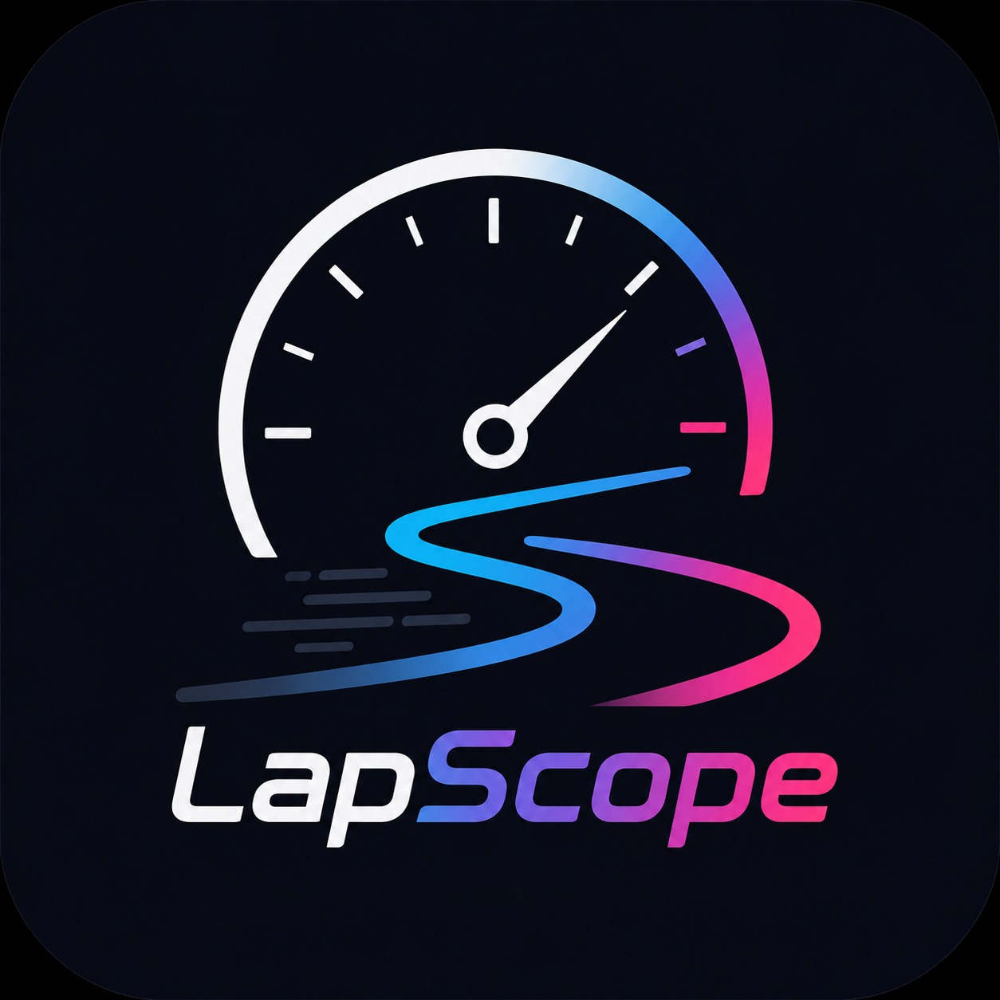
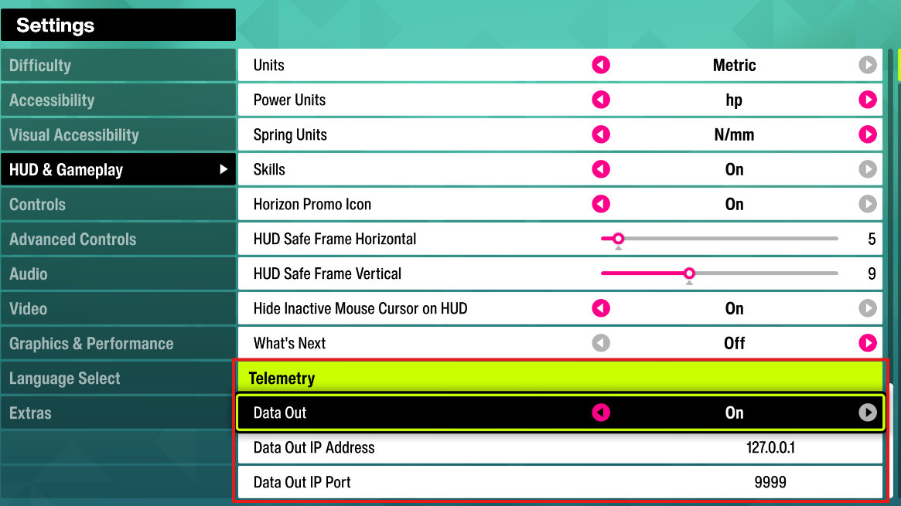
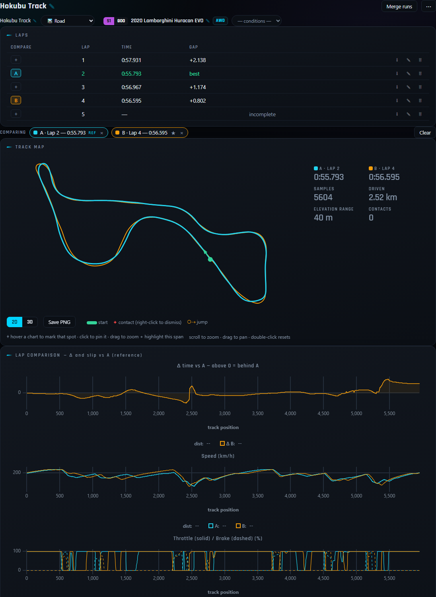

<div align="center">



<!-- # LapScope -->

**A self-hosted telemetry dashboard and lap analyzer for Forza Horizon 6.**

Runs on your own PC, reads the game's official "Data Out" UDP stream, and turns it
into a live driving dashboard plus a searchable history of every lap you drive — so
you can see *where* you're losing time and *why*.

[](../../releases)
[](../../actions/workflows/ci.yml)
[](LICENSE)


</div>

---

## What it is

LapScope listens for Forza Horizon 6's "Data Out" telemetry, shows it live in your
browser, and records timed drives to a local database so you can analyze and compare
laps afterwards. It's a single app you run locally — no cloud, no account, your data
stays on your machine.

The game only broadcasts *your* car (no rival data), so LapScope measures you against
your own best lap and the tires' grip limit — which is exactly what makes you faster
in Rivals.

## Quick start

### Windows (recommended — plug and play)

1. Download the latest **`LapScope-<version>-win64.zip`** from the
   [Releases page](../../releases).
2. Unzip it anywhere and double-click **`LapScope.exe`**.
3. The LapScope window opens and your browser follows at **http://127.0.0.1:8000**.
   Leave the window open while you play — it is the server, and closing it saves
   the lap you were on.

> If the build isn't code-signed yet, Windows SmartScreen may warn on first run —
> click **More info → Run anyway**. Every release lists SHA256 checksums, and you
> can rebuild and verify the download yourself: see [docs/BUILDING.md](docs/BUILDING.md).

### Docker (power / cross-platform users)

```bash
docker compose up --build -d
```

Then open **http://localhost:8000**.

> ⚠️ Compose publishes port 8000 on **every** interface and LapScope has no
> passwords — fine on a home LAN, but don't forward it through your router. To keep
> it on this machine, map `"127.0.0.1:8000:8000"`.

### In Forza Horizon 6 (required either way)

Turn on Data Out under **`Settings → HUD and Gameplay`**:

| Setting             | Value       |
|---------------------|-------------|
| Data Out            | `ON`        |
| Data Out IP Address | `127.0.0.1` |
| Data Out IP Port    | `9999`      |

Then just drive. Telemetry is only sent while you're driving (not in menus). You'll see
**"Waiting for telemetry…"** until the first packet arrives.

> ⚠️ Do **not** use ports **5200–5300** — the game binds its own socket in that range.



## Features

- **Live cockpit** — one car-dashboard view: tach and shift lights, friction circle,
  per-tire grip, inputs, and a lap timer with a **live delta to your session best**,
  on a track map that draws as you drive.
- **Lap comparison** — overlay up to 6 laps, even across sessions, on
  distance-aligned delta, speed, input and slip charts.
- **Racing line in 2D and 3D** — colored by speed or tire slip, with elevation and
  drag-to-rotate.
- **Jumps and contacts** — takeoff → touchdown flight lines, with hard landings told
  apart from real crashes.
- **Dirty-lap flags** — ⏪ rewind and 💥 contact are inferred and trimmed, and you can
  dismiss or re-tag any of them.
- **Every event type, timed** — races, Rivals, sprints, drags, touge, cross-country
  and World Time Attack; free-roam cruising is dropped.
- **Routes name themselves** — official courses are recognized from lap geometry, and
  anything else you name once.
- **Take it with you** — CSV export (curated or every packet field), CSV import, and
  a shareable PNG of the map.
- **Your units, your colors** — km/h or mph, °C or °F, kW / hp / PS, psi or bar,
  six accent themes.




**[Take the full Feature Tour →](../../wiki/Feature-Tour)** — every screen, with
what each part does.

## Troubleshooting

**No packets arriving?** Most common on Microsoft Store / Xbox-app (UWP) builds, which
can be blocked from sending to `127.0.0.1`:

1. Try `127.0.0.1:9999` first — it's officially supported by FH6.
2. If nothing arrives, use your PC's **LAN IP** instead (`ipconfig` → e.g.
   `192.168.1.20`), keeping port `9999`.
3. Check the server actually sees packets at **http://localhost:8000/api/status**.

Everything else — UWP loopback exemptions, the Docker port bug, busy ports, events
that aren't recorded — is on the **[Troubleshooting](../../wiki/Troubleshooting)**
wiki page.

## What LapScope contacts

Your telemetry never leaves the machine: no account, no upload, no analytics. LapScope
makes three *optional*, once-a-day requests for public files on GitHub:

- **the browser → `api.github.com`** — is there a newer release? (a dismissible
  notice; it never downloads anything)
- **the server → `raw.githubusercontent.com`** — the community car-name list
- **the server → `raw.githubusercontent.com`** — the official-route catalogue

Turn them off in **Settings → Privacy**, or for the whole install with
**`LS_OFFLINE=1`**. The bundled lists keep working either way.

## More documentation

- **[Configuration](../../wiki/Configuration)** — environment variables, offline
  mode, reverse proxies, storage and compacting, where the database and logs live.
- **[Feature Tour](../../wiki/Feature-Tour)** — the long version of the feature list,
  with screenshots.
- **[FH6 Data Out Packet](../../wiki/FH6-Data-Out-Packet)** and
  **[Event Detection](../../wiki/Event-Detection)** — how LapScope infers sessions,
  laps, finishes and dirty-lap flags from a stream that announces none of them.

## How it works

```
FH6 ──UDP 9999──▶ asyncio listener ──▶ parser (324-byte Data Out packet)
                                      ├──▶ WebSocket /ws/live ──▶ live dashboard
                                      └──▶ session/lap tracker ──▶ SQLite ──▶ REST /api ──▶ analysis page
```

A single FastAPI app with a vanilla-JS frontend (no build step). Packet layout
reference: [FH6 Data Out documentation](https://support.forza.net/hc/en-us/articles/51744149102611-Forza-Horizon-6-Data-Out-Documentation).

## Contributing

[Issues](../../issues) and PRs welcome — especially **captures of event types that
aren't detected yet** and **car-ordinal additions**. No game needed to work on it: a
built-in simulator replays realistic telemetry. Start with
[CONTRIBUTING.md](CONTRIBUTING.md); see [ARCHITECTURE.md](ARCHITECTURE.md) for the code
map, [AGENTS.md](AGENTS.md) for the dev workflow, and our
[Code of Conduct](CODE_OF_CONDUCT.md).

## License

[MIT](LICENSE) © 2026 Erdem Darcan.

### Third-party assets

- **[Rajdhani](https://fonts.google.com/specimen/Rajdhani)** display font — SIL Open
  Font License 1.1 (vendored in `app/static/fonts`).
- **[uPlot](https://github.com/leeoniya/uPlot)** charting library — MIT (vendored for
  the analysis page).

### Code signing

Windows releases are code-signed with a free code-signing certificate generously
provided by [SignPath Foundation](https://signpath.org/), using code-signing
infrastructure by [SignPath.io](https://about.signpath.io/).

> LapScope is an unofficial, fan-made tool and is not affiliated with or endorsed by
> Playground Games, Turn 10, or Microsoft. "Forza Horizon" is a trademark of Microsoft.
