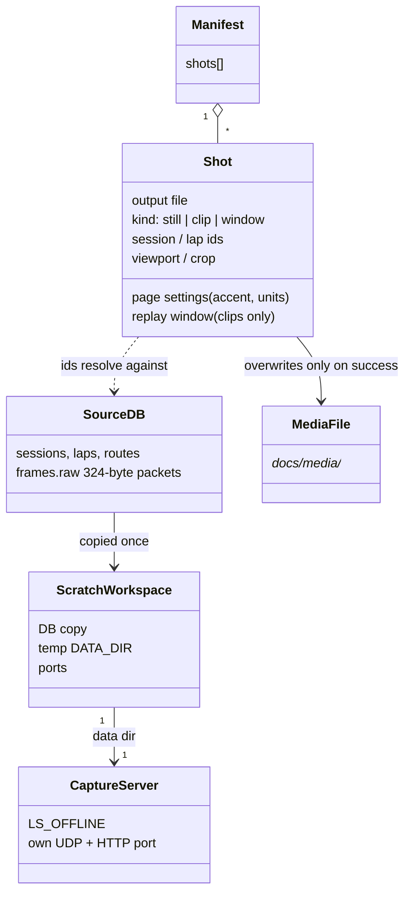
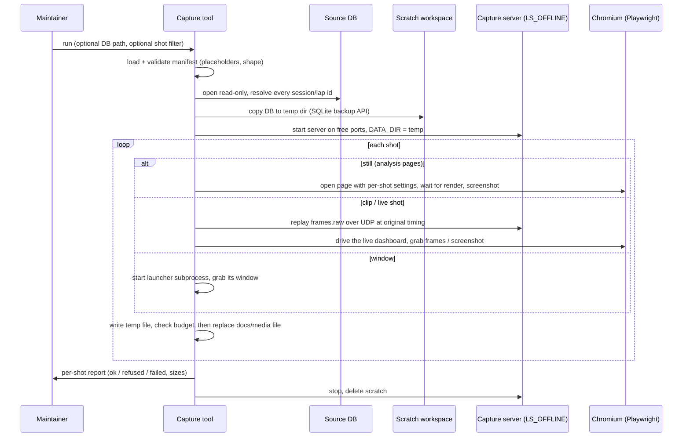

# Spec — #89 Refresh the project's media

## Overview

| | |
|---|---|
| Feature | A committed, re-runnable maintainer tool that regenerates every LapScope-UI image in the docs from a real `telemetry.db`, driven by an owner-edited shot manifest; plus the doc/repo changes around it. |
| Problem | Docs media is stale, partly missing for newer features, the hero GIF is 60 MB, and no repeatable refresh procedure exists. |
| Success | One command regenerates every shot in the shot list (except `fh6-settings.png`) into `docs/media/` (FR1, FR8, AC1). |
| Success | The source DB is byte-identical afterwards and a running LapScope is unaffected (FR3, AC2). |
| Success | The hero GIF is ≤ 10 MB, reported not written when over (NFR1, edge cases, AC3). |
| Success | No new runtime/CI dependency; `pytest -q` and `ruff check .` pass (FR7, NFR2, NFR3, AC6). |

## Domain model

## Technical approach

### Shape: one script under `tools/`, pure logic split from I/O

A single entry script in `tools/` (the repo's home for maintainer tools) with a small pure-logic layer (manifest, validation, replay reading and pacing) separate from the I/O layer (browser, server, window grab, GIF encoding). The split lets the pure layer be unit-tested on CI with only `requirements-dev.txt`; Playwright and Pillow are imported lazily, only when a shot needs them.

- Rejected: extending `tools/simulator.py` to capture. Published media must show real sessions (non-goal), and the simulator stays stdlib-only.
- Rejected: a pytest- or CI-driven capture. Non-goal; it is a local Windows maintainer tool.

### Run flow

### Decisions

| Decision | Rationale and rejected alternatives |
|---|---|
| Source DB is opened read-only and copied with SQLite's online backup into a temp data dir; the server only ever sees the copy. | Satisfies FR2/FR3/AC2 even if the source is WAL-active under a running LapScope. Rejected: plain file copy of `telemetry.db`, which can miss `-wal` content or tear mid-write. |
| The capture server is the real app started as a separate uvicorn subprocess with `DATA_DIR` = temp dir, `LS_OFFLINE=1`, and HTTP + UDP ports picked free from a range that excludes 5200–5300 and the default 8000/9999. | A subprocess isolates env vars and the lifespan (the recorder binds UDP at startup) and can be killed cleanly. Rejected: importing the app into the tool process, which leaks `DATA_DIR` and couples lifetimes. |
| Live-dashboard shots replay `frames.raw` from the temp copy to the capture server's UDP port, paced by stored `t` deltas (FR4). | Byte-exact packets exercise the real parse path. Rejected: a synthetic WebSocket feed, which bypasses what the user actually sees. |
| A replay is recorded by the capture server as a new session in the scratch DB; analysis shots reference the **original** ids, which exist in the copy. | Replay-created sessions never reach the source or `docs/media/`, and manifest ids stay stable. |
| Hero and animated 3D map are built from successive Playwright screenshots (hero while the replay window runs; 3D map by stepping the rotation) and encoded with Pillow into an optimized GIF. To fit budget the encoder lowers frame rate, then scale, then colors; if none fits, the shot fails and is reported (FR5, NFR1). | Pure Python, no ffmpeg (absent on target machines). Rejected: Playwright video plus ffmpeg (extra binary); writing an over-budget GIF with a warning (violates the edge case). |
| The launcher window is captured by starting `run_desktop.py` as a subprocess with `DATA_DIR` and `TELEMETRY_UDP_PORT` pointing at scratch values, locating its top-level window by title, and grabbing that rectangle with Pillow's screen grab (FR6). | Never imports `desktop/ui.py` (tkinter rule). The launcher's HTTP port is hard-coded to 8000, so if 8000 is already bound the shot is refused with that cause rather than touching a running install. Rejected: a launcher port override (an app runtime change, out of scope). |
| Playwright contexts also block non-loopback requests, in addition to `LS_OFFLINE`. | Belt and braces for FR3: no update banner can appear in any shot. |
| Each output is written to a temp file beside its target and replaced only after capture and size checks pass. | Failure leaves the existing media untouched (edge cases). |

### Manifest (FR8, FR9)

A committed, human-editable file under `tools/`, parseable without any dependency beyond `requirements-media.txt`; format fixed at plan time. One entry per shot in the shot list:

| Field | Purpose |
|---|---|
| output | File name under `docs/media/` |
| kind | still, clip, or window |
| ids | Session id and, where the shot shows laps, lap ids (comparison takes two) |
| viewport / crop | Browser size and optional clip region |
| page settings | Per-shot display preferences (Sunset accent, units, map mode) applied through the page's own `ls_settings` before load |
| replay window | Start/end offsets within the session's frames, for clips and live shots |

It ships with a documented placeholder sentinel in every id field. All selected shots are validated before any capture starts:

| Condition | Outcome |
|---|---|
| Placeholder id present | That shot refused, shot named; other shots proceed |
| Id absent from the DB | That shot refused, shot and missing id named |
| No DB at the default path and no override | Whole run aborts, path named |
| Capture fails | Reported; existing file untouched; run continues |

### Shot mapping

| Shot | Page / mechanism |
|---|---|
| `hero.gif` | Live dashboard, replay window of a circuit race, frame-grab clip |
| `analysis-compare.png`, `track-map.png`, `track-map-3d-jumps.png`, `session-list.png`, `session-sidebar.png`, `settings.png` | Analysis-page stills (settings opened via the gear panel) |
| `track-map-3d-animated.gif` | Analysis 3D map, rotation stepped and encoded |
| `accent-live-sunset.png` | Live dashboard in the Sunset accent, replay running |
| paused chip (new) | Live dashboard with the replay stopped mid-session until the amber paused chip shows |
| browse bar + overflow menu (new) | Analysis page with the ⋯ menu open, cropped to header and browse bar |
| CSV export choice (new) | Analysis page with the #90 export dialog open |
| launcher window (new) | Window grab, see decisions |

File names of the four new shots are fixed at plan time and used identically in the manifest and README (FR11).

## Impact

| Area | Change |
|---|---|
| `tools/` | New capture tool and manifest; pure-logic unit tests under `tests/` that need neither Playwright nor Pillow (A1). |
| `requirements-media.txt` | New: Playwright, Pillow. `requirements.txt` and `requirements-dev.txt` untouched (FR7). |
| `docs/media/` | The 7 unreferenced files are deleted (FR10). No recaptured media committed in this PR. |
| `README.md` | Four new image references: launcher in the Windows quick start; paused chip in "Works when things go wrong"; browse bar/⋯ menu and CSV export in the Analysis showcase (FR11). They render broken until the owner commits media (accepted). |
| `docs/MEDIA.md` | New maintainer doc: setup (`requirements-media.txt`, `playwright install chromium`), filling the manifest, running, checking sizes, committing (FR12). |
| `AGENTS.md`, `ARCHITECTURE.md` | Pointer in the documentation map and the Tools section; the latter says tools are stdlib only, so it notes this one as the media-deps exception. |
| `.gitattributes` | Unchanged; `*.gif` stays on LFS (NFR1). |
| App runtime, exe, CI | None (NFR3): nothing under `app/` or `desktop/` imports the tool. |

AC4 check: after deleting, nothing in README, wiki or docs references a removed file. The kept `track-map-3d-jumps.png` is referenced by README and `docs/wiki/Event-Detection.md`; the regenerated file keeps that name so both stay valid.

## Non-functional

| Concern | Position |
|---|---|
| Security | Loopback-only server; `LS_OFFLINE` plus request blocking; source DB read-only; scratch dir removed on exit including on failure. |
| Privacy of media | Real sessions may show personal text (car and route names, custom names). MEDIA.md tells the maintainer to inspect outputs before committing. |
| Performance | Replay is real time, so a run is minutes. Clip frame rate is bounded by Chromium screenshot latency; the encoder resamples to budget. |
| Compatibility | Windows maintainer machine (launcher grab is Windows-only); ruff-clean (NFR2); the repo's Python version. |
| Migration | None. The scratch copy runs the app's normal startup migrations in the scratch dir only. |
| Git LFS | New GIFs go through the existing rule; MEDIA.md notes LFS must be installed where the media is committed. |

## Out of scope

- Committing recaptured media, recapturing `fh6-settings.png`, CI or non-Windows runs, simulator imagery in published docs, any app or exe change (requirements non-goals).
- A launcher option for its HTTP port.

## Risks and open questions

| Item | Handling |
|---|---|
| Launcher HTTP port is fixed at 8000; a running install blocks that shot. | Refuse that shot with a clear message; documented in MEDIA.md. |
| Window grab depends on the window being unobscured and on DPI scaling. | Make the process DPI-aware and raise the window before grabbing; a bad grab is a per-shot failure, verified only on the owner's machine. |
| Paused-chip and hero shots depend on the dashboard's stale-detection timing. | The paused shot stops UDP and waits past the threshold; timings are manifest-tunable. |
| Some settings or states (open menu, dialog) have no storage key. | Driven by clicks; selectors may drift with the UI, and MEDIA.md says where to update them. |
| Hero may not reach ≤ 10 MB for a long or high-motion window. | Degradation ladder, then a reported failure; the owner shortens the replay window. |
| Playwright and Chromium version drift. | Lower bounds in `requirements-media.txt`; maintainer-only. |
| A1 proof must not touch `docs/media/`. | The tool takes an output-directory override (default `docs/media/`); the E2E run on a simulator-recorded DB writes to a scratch dir. |
